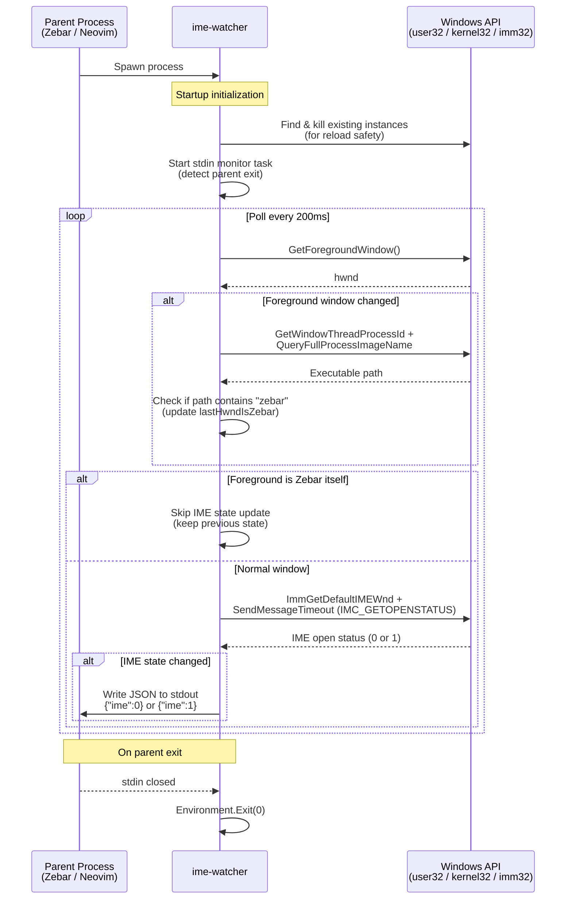

# ime-watcher

A tiny Windows tool that watches the IME state of the foreground window and outputs JSON when it changes.

## Usage

Run `ime-watcher.exe`. It stays running in the background and prints a JSON line whenever the IME open/close state changes:

| Output      | Value | Description                   |
| :---------- | :---- | :---------------------------- |
| `{"ime":1}` | `1`   | IME is open (Japanese input)  |
| `{"ime":0}` | `0`   | IME is closed (English input) |

On startup, it outputs the current IME state once within about 200ms (the first check). After that, it only outputs when the state actually changes.

Designed to be launched as a background process from tools like Zebar (`shellSpawn`) or Neovim (`jobstart` / `vim.system`) and consumed via `stdout`.

## Sequence Diagram

## Multiple Instances

When a new instance is launched while another is already running, the old process is terminated and the new one takes over (reload behavior).

## Polling Interval

The check interval is currently fixed at **200ms**. There are no command-line options at this time.

## Features

- Outputs only when the state changes (after the initial check).
- Replaces any existing instance automatically on startup.
- Exits automatically when the parent process dies (stdin closed).
- Single file, no external dependencies.
- Low CPU usage.

## Build & Release

- **Build:** Run `build.bat` to output `ime-watcher.exe` to the `bin/` directory.
- **Release:** Run `release.bat` to package the executable and `LICENSE` into `release/ime-watcher.zip`.

## Requirements

- Windows
- .NET Framework 4.0 or later

## Notes

- Tested on Windows 11 with the modern Microsoft IME.
- For single-shot get/set, see [ime-state](https://github.com/yuruyurau/ime-state).

## License

See the [LICENSE](LICENSE) file.
